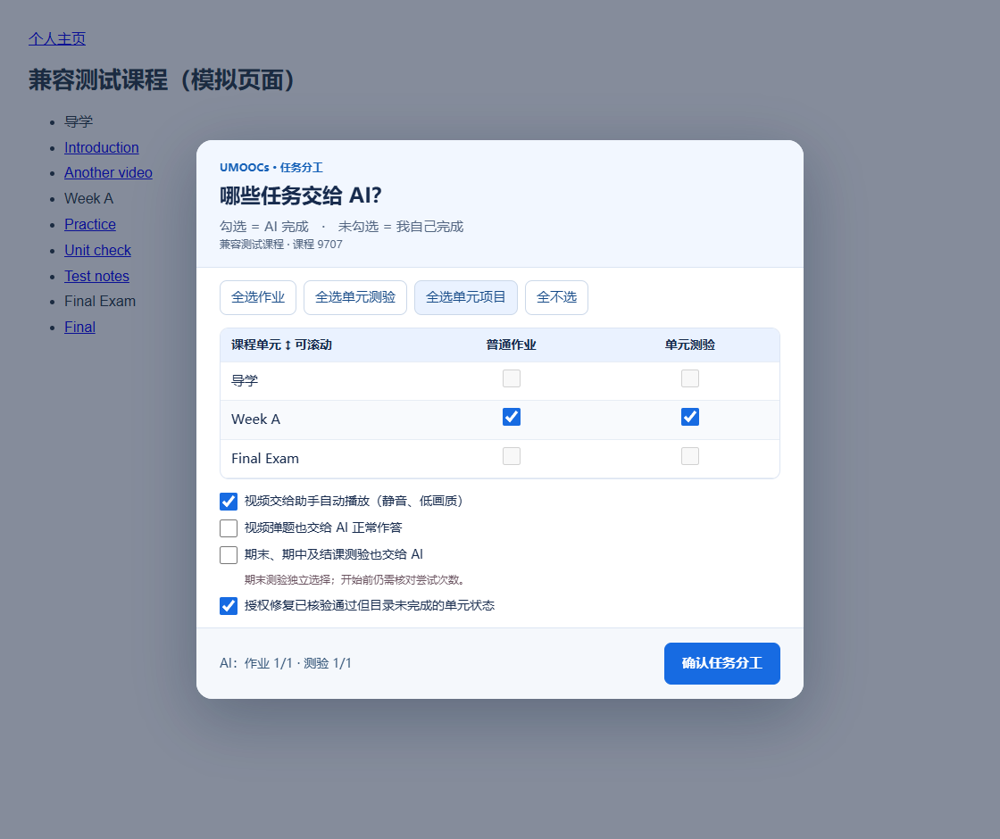

# UMOOCs 平台学习智能体

面向 UMOOCs 标准课程页面的多课程 Agent Skill：动态识别课程与任务、勾选 AI 分工、视频连续播放、AI 解题与正常提交、批阅及目录双重核验。

按实际课程目录生成任务清单与分工，支持不同章节结构和任务数量；每门课程分别核验播放器、题型与完成条件。

## 功能

- **视频速刷与连续播放**：经当前课程实测确认后，拖动进度条到视频结束前3秒，从最后3秒开始播放至结束；失败或目录不认可时改为16×从头完整播放，再失败以1×完整播放，仍未完成则停止提示。
- **静音、低画质、倍速选择、可拖动面板**：减少打扰及网络占用。只使用实际播放器可用的清晰度和倍速，显示实际播放速度。
- **AI普通作业**：提取完整题目、材料、选项与字段，独立解答，填写后读回，再正常提交；允许重复尝试时按错题反馈修正。
- **AI单元测验与期末考**：只有明确分工及开始/提交授权才执行。一次性测试独立解答两遍、比较分歧、逐题复核及读回后提交一次。结果不明只查状态，不再次交卷。
- **启动勾选面板**：从真实目录生成单元、周次或章节；分别勾选作业和测验，期末/期中/结课测验独立选择。未勾选由自己完成。
- **视频弹题**：识别播放器中当前可见的弹题；已授权时由智能体解答，选中读回后通过正常按钮确认。没有授权则提示人工处理，不关闭或跳过弹题。
- **完成状态核验及修复**：保留原任务页与活动iframe交卷；核验成绩和服务器目录。已授权且真实结果满足条件时，可在匹配的通知模块版本下补发平台原有单元完成通知；已完成直接跳过，不改分数、不重新交卷。

## 安装与使用：可直接复制

**先把目标课程加入“我的课程” → 安装技能 → 发启动指令 → 亲自登录 → 勾选并确认。**

### 1. 首次安装：复制给智能体

```text
请从 https://github.com/Howltan-Neo/umoocs-platform-agent 安装
skills/umoocs-platform-agent 这个技能，保留整个文件夹。
使用你所在环境的技能安装功能，读取 SKILL.md 和必要参考文件。
检查浏览器操作、文件读写、页面脚本写入及持续执行能力。
优先使用允许的 DOM 工具，否则使用正常界面操作。
请自主完成安装和环境检查，告诉我是否需要重新打开应用。
```

### 2. 启动：替换课程链接后复制

```text
使用 $umoocs-platform-agent 处理这门课程：[课程链接]
先打开页面让我亲自登录，再读取真实目录并显示任务勾选面板。
我会勾选交给 AI 的项目，未勾选自己完成；不要替我确认分工。
我授权正常开始并提交我确认交给 AI 的作业和测验。
核对尝试次数、计时及完成条件；未知机会数先跳过并汇总。
普通作业先试一份，核验成功后预先授权继续所选普通作业，
允许重试时可按反馈再尝试最多两次。
一次性测试独立解答两遍、比较分歧、复核并填写读回后只提交一次。
期末、期中及结课测验只有我独立勾选才包含；已交卷的单次测试不重做。

我授权在本课程所选视频样本试验拖动进度条到结束前3秒，
从最后3秒播放至结束并核验目录，通过后用于其他所选视频。
失败时16倍速从头完整播放，再失败1倍速完整播放，仍未确认停止提示。
优先静音、最低可用画质，不伪造记录、不跳过弹题。
视频弹题和单元完成通知修复按我独立勾选的范围执行；
修复仅用于真实已提交、批阅满足条件且通知版本匹配的单元项目，
不改分数、不重交卷、不用于期末等结课测试。
稳定视频交给脚本，尽量减少反复监测；重要材料或权限缺失时提醒我。
保存简短进度，结束后清理临时题目答案与登录测试配置，汇总实际结果。
```

### 3. 勾选并保持运行

在智能体打开的浏览器里亲自登录，回复“已登录”，不要发送密码或验证码。**勾选交给 AI，未勾选自己完成**，作业与单元测验分别选择；期末独立选择。“全选单元项目”不会包含期末。

视频和单元状态修复默认勾选；作业、测验、期末与 AI 视频弹题默认不选。核对后按 **确认任务分工**，无需手写 JSON。保持电脑唤醒、网络连通、浏览器及智能体任务运行。



### 4. 中断后继续：复制即可

```text
使用 $umoocs-platform-agent，读取本账号上次分工与进度，
核对实时目录及已提交结果，继续此前已授权的未完成任务。
跳过已完成项目，不重开或重交一次性测试。
账号或目录改变时重新核对范围，不沿用另一账号授权。
```

**[详细使用说明](docs/usage.md)** 包含手动安装、油猴安装、面板每个控件、视频配置、成绩核验及常见问题。**[完整 Prompt 清单](docs/prompts.md)** 包含安装、启动、续接、修改选择、换账号、只修复状态和停止，可直接复制。

智能体停止后不会继续推理答题；视频脚本可在浏览器保持打开且已经配置时串播。技能与油猴本身不是全天候 AI 后台服务。只读浏览器不能注入脚本时使用宿主允许的界面操作，必要时一次确认分工。

## 单刷视频：不做作业和测验

适合只需要视频串播的人。可以不选择任何答题任务；技能配置一次后，视频由浏览器脚本持续执行。

### 方法 A：让智能体安装并配置（操作最少）

把课程加入“我的课程”，安装技能后，复制下面的指令并替换课程链接：

```text
使用 $umoocs-platform-agent，仅处理课程视频：[课程链接]
普通作业、单元测验、期末、期中和结课测试全部由我自己完成，
不要开始或提交这些任务，也不要执行作业与测验状态修复。
打开页面让我亲自登录，显示任务面板，待我确认视频范围后再启动。
请安装或配置视频助手，核对当前账号与真实视频白名单，跳过已完成视频。
我授权在这门课一个所选视频样本测试定位到结束前3秒，
从最后3秒正常播完并核验服务器目录；通过后再用于其他所选视频。
失败则16倍速从头完整播放，再失败1倍速完整播放，仍未确认则停止提示。
优先静音和最低可用画质。视频弹题我自己完成，不关闭或跳过。
验证串播稳定后交给脚本运行，不持续轮询或额外解题。
告诉我应保留哪个浏览器窗口、脚本是否已经实际启用及当前模式。
```

面板中只保留 **视频自动播放** 勾选，取消 **单元状态修复**，答题和期末等项目都不选。如果希望弹题也由 AI 作答，可独立勾选弹题并明确授权，处理期间需要智能体保持运行。

### 方法 B：自行安装 Tampermonkey 视频脚本

1. 在你准备播放课程的浏览器安装并启用 Tampermonkey；已有则跳过。
2. 打开 [UMOOCs 视频助手脚本](skills/umoocs-platform-agent/assets/umoocs-video.user.js)，点击 **Raw**。若出现油猴安装页，点击安装。
3. 没有安装页时：油猴 → 添加新脚本 → 删除默认模板 → 粘贴完整脚本 → 保存并启用。
4. 在这个浏览器亲自登录 UMOOCs，打开目标课程目录。
5. 把上面的“仅处理课程视频”指令发给智能体，注明“油猴已安装，请在这个浏览器配置”。智能体需核对账号、课程、视频白名单以及当前课程的跳转试验结果。
6. 配置后刷新目标课程页，确认出现视频助手并开始处理所选未完成视频；保留一个有效串播页。

**本脚本采用账号绑定和视频白名单。只有安装、尚未配置时会等待智能体，不会直接处理全部课程。** 配置保存在该浏览器的平台本地存储中；更换浏览器、账号、课程或清除站点数据后，需要重新配置。

### 视频小窗口怎么操作

| 控件或状态 | 操作及含义 |
|---|---|
| 最后3秒开始播放 | 已在当前课程验证时，将进度条定位至结束前3秒，以1倍速播放至自然结束 |
| 完整播放 | 从头正常播放，使用倍速选择值 |
| 1×／4×／8×／16× | 选择完整播放速度；面板显示播放器实际采用的速度 |
| 暂停串播 | 暂停自动推进，当前媒体可能仍在播放；要暂停画面请使用播放器暂停按钮 |
| 继续串播 | 恢复自动处理，按最新目录核对未完成视频 |
| ⋮⋮ 拖动手柄 | 按住移动；保存位置并在刷新、下一节沿用，也可聚焦后用方向键移动 |
| 等待配置 | 账号与视频范围尚未建立，使用上面的配置指令 |
| 本次选择的视频已完成 | 只表示所选视频已完成，不代表课程的作业与测验完成 |

默认静音，优先播放器原生“流畅”，其次“标清”；没有这些菜单时不会虚构低画质结果。只保留一个有效视频助手，避免多个脚本重复控制同一播放器。

### 能否关掉智能体，让视频自己跑？

配置并验证稳定后可以结束智能体推理，视频脚本在浏览器保持打开、电脑未睡眠和网络正常时继续串播。**脚本没有 AI 解题能力**：遇到弹题或必要人工交互会暂停提示；你可以亲自完成后继续，或让智能体在授权内处理。关闭浏览器、电脑睡眠或断网可能中断播放。

### 如何知道视频真的完成了？

脚本等待媒体自然结束，再读取服务器课程目录。定位失败或最多120秒内未确认完成，改为16倍速从头完整播放；仍未确认则1倍速完整播放，再失败停止提示。不要仅凭播放条到末尾就认定完成，最终以服务器目录为准。

## 更多可复制的使用指令

### 重新选择任务

```text
重新打开任务勾选面板，让我修改尚未开始的任务。
在我确认前不要开始新的作业或测验。
先说明当前是否有已开始且计时的试卷。
```

### 换账号或换课程

```text
我要使用另一个账号或另一门课：[新课程链接]
请建立独立配置，打开页面让我亲自登录，重新识别目录并显示勾选面板。
不要继承旧账号的任务选择、视频完成验证或一次性测试记录。
待我确认新的分工及授权后再开始。
```

### 只修复已提交但目录未完成的单元状态

```text
使用 $umoocs-platform-agent，仅检查本课程已经提交但目录未完成的单元项目。
先核验真实批阅结果，不再次填写或交卷。
我授权在结果满足技能规定条件、账号与模块版本匹配时，
恢复平台原有单元完成通知，每项最多一次，再核验目录。
期末、期中、结课测试不使用该修复；不符合条件的项目记录异常。
```

### 停止执行

```text
停止开始新的作业和测验，暂停视频串播，保存简短进度。
如果正在计时的试卷尚未提交，先告诉我当前状态和剩余时间，等待我决定。
```

## 详细操作手册

### 一、使用前准备

1. 在 UMOOCs 平台亲自登录，找到目标课程并加入“我的课程”。
2. 从“我的课程”打开该课，复制实际课程链接。使用你实际加入的课程链接；不同课程或开课轮次的 ID 可能不同。
3. 选择支持 Agent Skills、浏览器操作、文件读写和持续执行的智能体。纯文本聊天不能直接控制课程；油猴脚本本身不负责 AI 解题。

**最少操作：安装一次 → 发启动指令 → 亲自登录 → 勾选任务并确认。**

完整可复制指令见 [Prompt 清单](docs/prompts.md)。

### 二、安装技能

#### 推荐：让智能体自动安装

复制 [安装 Prompt](docs/prompts.md#1-安装首次使用) 发给智能体。仓库地址是 `https://github.com/Howltan-Neo/umoocs-platform-agent`，技能目录是 `skills/umoocs-platform-agent`。请保持整个文件夹完整，不只复制 SKILL.md。

安装器和技能发现目录因宿主版本而异，让智能体使用所在环境的安装功能；安装后未出现时，重新打开应用再调用技能。已有同名技能更新一份即可。

#### 手动安装：没有自动安装器时

1. 在 GitHub 仓库点击 **Code → Download ZIP** 并解压。
2. 找到 `skills/umoocs-platform-agent`，把整个文件夹复制到你的智能体技能目录。
3. 重新打开智能体，发送启动 Prompt。

没有技能发现功能但能操作浏览器的智能体，可让它直接读取该目录的 SKILL.md 和链接资源。未逐一验证所有第三方产品，不能承诺各宿主操作完全一致。

### 三、启动并登录

复制 [启动 Prompt](docs/prompts.md#2-启动勾选与一次授权)，将 `[课程链接]` 换成你的课程链接后发送。

在智能体打开的课程浏览器里亲自登录，完成验证码，回复“已登录”。不要把密码、验证码或 Cookie 发到聊天里。你平常使用的浏览器已登录，不代表智能体自己的浏览器会话也已登录。

### 四、勾选哪些任务交给 AI

面板根据真实目录生成章节或周次，并显示对应任务数量。预览是模拟页面，真实页面显示你的课程名称和实际任务数量。

| 控件 | 含义与默认值 |
|---|---|
| 每行“普通作业” | 勾选该章节普通作业交给 AI，默认不选；无此类任务时不可选 |
| 每行“单元测验” | 勾选该章节单元测验交给 AI，默认不选；无此类任务时不可选 |
| 全选作业／全选单元测验 | 选择对应单元类别，不包括期末考 |
| 全选单元项目 | 选择普通作业和单元测验，不包括期末考 |
| 全不选 | 清除单元作业、单元测验及期末选择；视频、弹题和修复选项保持原值，需分别核对 |
| 视频自动播放 | 默认勾选；只处理分工内的视频 |
| 视频弹题交给 AI | 默认不选；未选时遇弹题等待人工处理 |
| 期末、期中及结课测验交给 AI | 独立选择，默认不选，不被“全选单元项目”包含 |
| 授权修复已核验但目录未完成的单元状态 | 默认勾选；只在实际结果满足条件且适配版本匹配时执行 |

**勾选 = AI 完成；未勾选 = 自己完成。** 列表可以滚动，确认前核对底部数量与独立选项，再点击 **确认任务分工**。勾选本身不会立即启动或交卷；智能体还需核对你的开始和提交授权。

以后说“重新打开任务勾选面板”即可调整尚未开始的任务。已经消耗的一次机会无法撤销；正在计时的试卷需先说明状态。

### 五、视频助手与油猴脚本

推荐让智能体自行配置并注入助手；已有 Tampermonkey 时也可安装一次：

1. 打开 [视频脚本](skills/umoocs-platform-agent/assets/umoocs-video.user.js)，点击 **Raw**。
2. 若未出现安装页，在 Tampermonkey 中“添加新脚本”，替换默认内容为完整脚本，保存并启用。
3. 返回智能体，让它按当前账号、实际课程目录和勾选范围写入配置。**只安装脚本、没有账号绑定及视频白名单时，不会自动开跑**；面板会等待配置。
4. 保留一个串播页，避免多个视频脚本同时控制同一课程。

#### 播放逻辑

每门新课先试验并核验所选样本。通过后才能使用“最后3秒开始播放”：等待元数据，拖动进度条到结束前3秒，从最后3秒以1倍速播放至自然结束，再核验服务器目录。这不等于完整观看，也不能从另一门课成功推断当前课可用。

无法定位或最多120秒内目录未确认时，从头16倍速完整播放；仍未确认则从头1倍速完整播放，再失败停止提示。不同播放器或规则需先适配。弹题不会被关闭或跳过，授权 AI 弹题时由智能体正常作答。

#### 面板按钮

- **方式选择**：最后3秒开始播放／完整播放。
- **倍速选择**：1、4、8、16倍速，完整播放时使用；末尾3秒采用1倍速自然播完。
- **暂停串播**：停止自动推进，当前视频可能仍在播放；需要暂停媒体可使用播放器本身按钮。
- **拖动手柄 ⋮⋮**：按住移动，位置会保存，刷新及下一节沿用。

优先静音及播放器原生最低可用画质；菜单有“流畅”时优先流畅，其次标清，没有对应菜单时不声称已降画质。

### 六、作业、测验与结果核验

普通作业先核对重复尝试规则，再解答、填写、读回、正常提交；允许重试且在授权内时按反馈修正。读回只能证明输入一致，不能证明学术答案正确。

一次性测验独立解答两遍，比较分歧、复核材料和格式后，只交一次。遇重要歧义、材料缺失或未知机会数按启动授权处理；不能承诺满分。已交卷的一次性测试不重做，提交结果不明只检查状态。

在原任务页的活动 iframe 中交卷，核验批阅、成绩及服务器目录。已核验结果满足条件但目录仍未完成时，按勾选和授权恢复平台原有单元通知，再核验；不改答案分数、不重新提交。通知版本不匹配停止，该适配器不用于期末、期中和结课测试。

### 七、运行、续接、换账号和停止

保持电脑唤醒、网络连通及播放浏览器打开；解题期间保持智能体任务运行。安装技能不会建立全天候后台服务。智能体停止后，视频脚本可以继续串播，新的解题需要智能体仍在执行。

中断后复制 [续接 Prompt](docs/prompts.md#3-中断后继续)，读取简短进度并核对实时目录。换账号或课程使用 [切换 Prompt](docs/prompts.md#5-切换账号或课程)，重新确认分工和该课程的视频验证，不能继承另一账号授权。

需要停下时复制 [停止 Prompt](docs/prompts.md#7-停止)。未提交且正在计时的试卷要先确认状态，不能保证暂停计时。

### 八、常见问题

| 情况 | 最少操作 |
|---|---|
| 安装后找不到技能 | 重新打开智能体，让它检查安装目录与发现机制 |
| 没有勾选面板 | 说“请先显示任务勾选面板”；宿主不允许页面写入时，由智能体使用允许的界面或一次确认分工 |
| 视频提示等待配置 | 让智能体读取真实目录、账号和所选范围，完成白名单配置 |
| 目录仍显示未完成 | 先核验实际成绩，再按授权检查同步；不要自行重新交一次性试卷 |
| 弹题后暂停 | 已选 AI 弹题且智能体仍运行时正常解答，否则亲自处理或补充授权 |
| 无法使用某个题型或播放器 | 让智能体检查适配，无法确认时保留异常；不要盲目继续 |

### 九、分享与清理

分享仓库链接或本地技能 ZIP 即可。不要分享 runtime、登录配置、Cookie、题目答案或身份信息。任务结束按授权清理临时运行数据，保留技能、说明、回归测试和匿名结果。其他账号需重新登录、识别课程和确认分工。


## 兼容范围与真实测试

本版本适配标准任务目录、标准HTML5云播放器及标准试卷字段。**不能凭3门课程的样本声称已经覆盖全站大部分课程。** 新课程先识别、抽查规则与播放器，再启用对应功能。未知任务类型、音频、文档阅读、富文本或文件上传等不同页面，需由智能体另行适配；不会因标题含“Test”就当作试卷。

2026-10-10，独立测试账号在两门新增课程中验证：

| 课程 | 目录识别 | 视频 | 作答 |
|---|---|---|---|
| 大学英语学术阅读（8339） | 75项：31视频、31文档、12作业、1期末考 | 最后3秒播放自然结束；静音、标清；2道弹题正常作答均正确；目录完成 | 普通作业1/1正确，目录完成，结果页可再次尝试 |
| 工科学术英语读写与交流（7822） | 52项：31视频、17文档、3单元测验、1期末考 | 最后3秒播放自然结束；静音、标清；目录完成 | 单元测验只提交一次，80/100，目录完成 |

新增课程的期末考没有用于此次试验。7822无普通作业类型，8339无单元测验类型，因此没有虚构不存在的试运行。测验中有一道错题，AI作答不保证满分。素材不足或答案存在歧义时应记录风险，不把自动操作成功当作答案全对。

状态通知模块的实际恢复曾在8021课程测试账号中核验；新课程本次正常在任务iframe提交即可完成，未人为制造漏通知来测试恢复。播放器兼容、通知版本及题型覆盖的详细范围见 [测试记录](docs/validation.md)。

## 文件结构

- skills/umoocs-platform-agent/：可安装的技能源码与浏览器助手。
- docs/：中文使用、适配与测试说明。
- tests/：不含真实题目或身份的浏览器回归测试。
- dist/：本地生成的分发ZIP，不必安装两份同名技能。
- runtime/：本地临时运行目录，被Git忽略；不上传登录配置、Cookie、题目和答案，测试后清理。

[使用说明](docs/usage.md) · [适配机制](docs/architecture.md) · [测试记录](docs/validation.md)


## 相关项目

[《英语语法与写作》课程助手](https://github.com/Howltan-Neo/unipus-course-assistant)：面向该课程的专用适配与使用说明。


